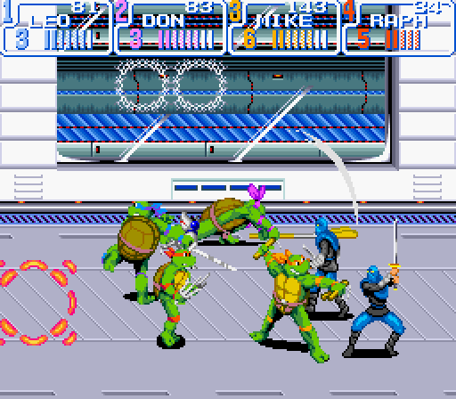

# SNES Turtles in Time 4 player hack

This is a ROM hack for the SNES version of *TMNT IV: Turtles in Time* that lets four people play at the same time. If you have a Turtles in Time SNES ROM dump, [you can try the hack on the web at this link](https://tmnt.downtowndougbrown.com).

[](https://www.youtube.com/watch?v=KA0fcrUBpSE)

[YouTube video demonstrating gameplay](https://www.youtube.com/watch?v=KA0fcrUBpSE)

The SNES does not have enough power to support four simultaneous players in Turtles in Time because with four turtles there would be too many sprites on the screen at the same time. Thus, in order to actually run this hack, you have to use a special emulator: [mesen-tmnt4p](https://github.com/dougg3/mesen-tmnt4p), which is a fork of Mesen that adds some extra capabilities to the emulated SNES. In particular, it adds support for more sprites and palettes, overclocks the CPU to minimize lag, and adds a second Mode 7 layer.

## AI disclosure

This ROM modification was largely made possible with the use of Claude Opus 5.5. I've tried to keep the documentation as human-written as possible, and have done a bunch of play testing by hand to help weed out bugs. There's a good chance there are still bugs. Please let me know if you notice any issues!

## Why even do this?

Some people may wonder: what's the point? Why should anyone even bother with this hack? The arcade version of Turtles in Time already supports four players. Does the world really need yet another annoying AI-generated game hack? My response to those questions is: this fills a real void. The SNES version of the game was quite a bit different from the arcade version. It added the Technodrome level, changed the gameplay in existing levels, and swapped out some of the bosses. Four-player support in the SNES version provides a completely new experience that was previously not possible. Plus, it's my childhood dream to be able to play this version of the game with four players.

## Supported versions of the game

You need an original dump of the game in order to play. These versions are supported:

| Version | SHA-1 of the ROM |
|---|---|
| USA | `4f8fc0f45023e0339e501054b253c33f479a001a` |
| Europe | `59add584f16b607607348e65c245ca6ad7a5fcb8` |
| Australia | `c4ba9b0fd1b40a228e6bb1170ec227dac5b83ce5` |
| Japan | `514e7fb70e1e5e06c5a873262e145a555655d62d` |

## Playing

The easiest way to play is to use the [online WebAssembly version](https://tmnt.downtowndougbrown.com) in your browser. You just have to provide your original ROM dump, and it will automatically patch it and let you play with 4 players. You can use your game controller(s) in the browser, and you can also add (terrible) bot players if you want to try the 4-player experience without four actual people.

You can also play it on your local machine using the mesen-tmnt4p emulator fork. [Here are downloads for Windows, Mac, and Linux](https://github.com/dougg3/mesen-tmnt4p/releases). The [online WebAssembly version](https://tmnt.downtowndougbrown.com) lets you download a 4-player patched ROM if you provide an original ROM. **Again, to be clear, the patched ROM will only run correctly in the special mesen-tmnt4p emulator linked here.** You will also need to set up the controller configuration in mesen-tmnt4p. Set port 1 as an SNES controller, port 2 as a Super Multitap, and then attach SNES controllers to ports 1-3 of the Multitap.

## Building the patched ROM

Currently, only Ubuntu Linux is tested for building all of this. Start by installing all prerequisites:

```
sudo apt install git curl make cmake clang python3 python3-pil libsdl2-dev xz-utils
```

Then, download and set up all other dependencies:

```
scripts/setup.sh
```

If you are trying to build the browser version, add `web` as an argument to `setup.sh`.

Put your stock Turtles in Time ROM(s) in `original/` (see `scripts/build.sh` for the expected file names), then:

```
scripts/build.sh [us|eu|au|jp]
```

This builds the patched sfc file that can be played in the [mesen-tmnt4p fork containing all of the SNES enhancements](https://github.com/dougg3/mesen-tmnt4p).

## Reporting problems

If you run into problems, please open an issue on GitHub. If you were playing the browser version, "Save session log" saves everything needed to perfectly replay your session. Attach the session log to the issue.

## License

GPL-3.0; see `LICENSE`.

This project is not affiliated with or endorsed by Konami or the license holders of the Teenage Mutant Ninja Turtles franchise. No part of the original game is included; you need your own copy.
